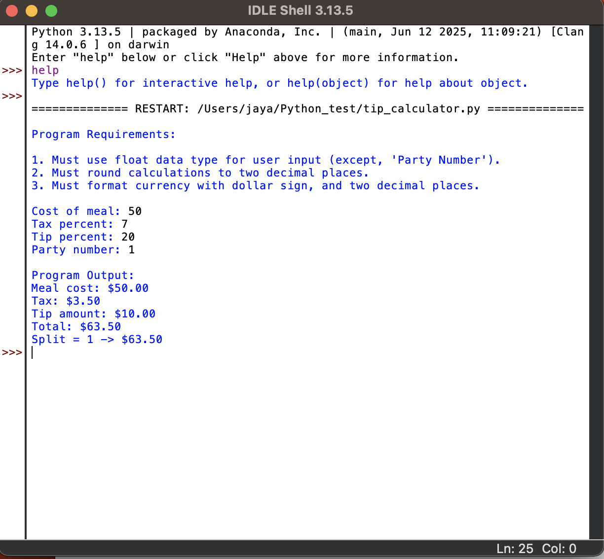
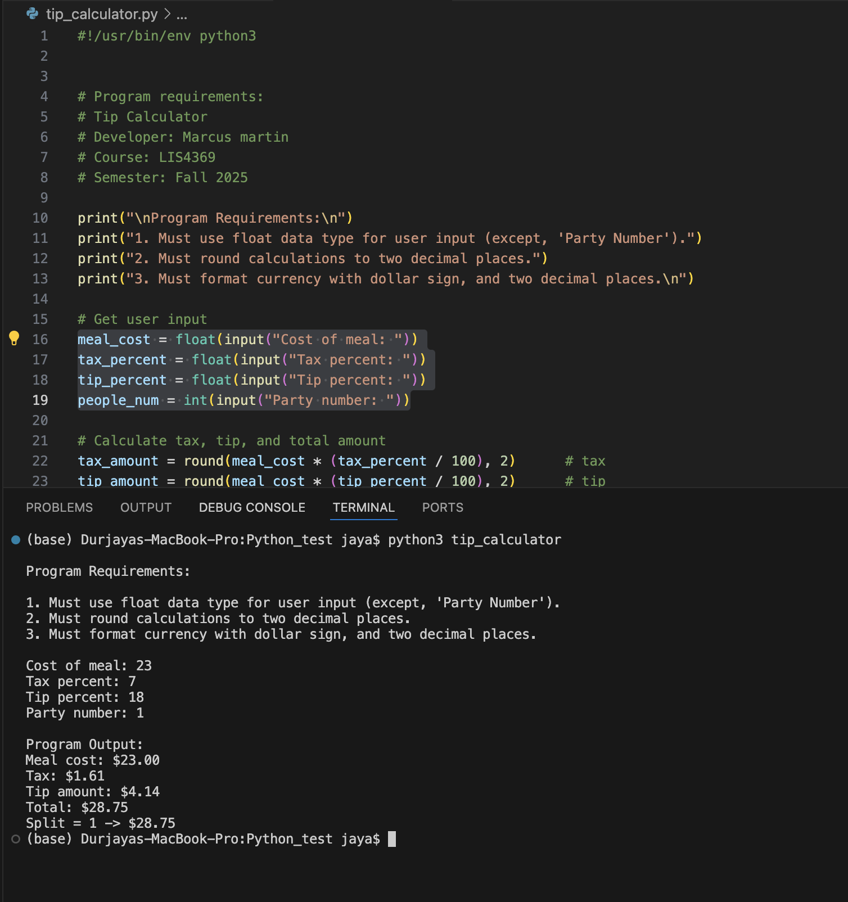
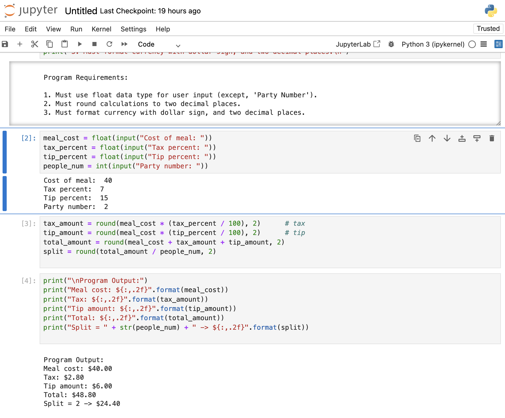

**NOTE:** This README.md file should be placed at the **root of each of your main 
directory.**

# LIS4369 

## Marcus Martin

### Extensible Enterprise Solutions

*Course Work Links:*

1. [A1 README.md](a1/a1_README.md "My A1 README.md file")

    - Setup git distrubution and remote repo
    - Install Python 
    - Install R studio 
    - Use jupyter lab

# **Git Commands with Description**

| **Git Command** | **Description** |
|-----------------|-----------------|
| `git init`      | Initialize a new Git repository in the current directory. |
| `git add`       | Stage changes (files) to be committed. |
| `git commit`    | Save staged changes to the repository history. |
| `git push`      | Upload local commits to a remote repository. |
| `git pull`      | Fetch and merge changes from a remote repository. |
| `git clone`     | Create a copy of a remote repository locally. |
| `git status`    | Show the current state of the working directory and staging area. |

#### Assignment Screenshots 

#### Link to my ipynb files
[Jupyterlabfile](tip_calculator.ipynb)

  

