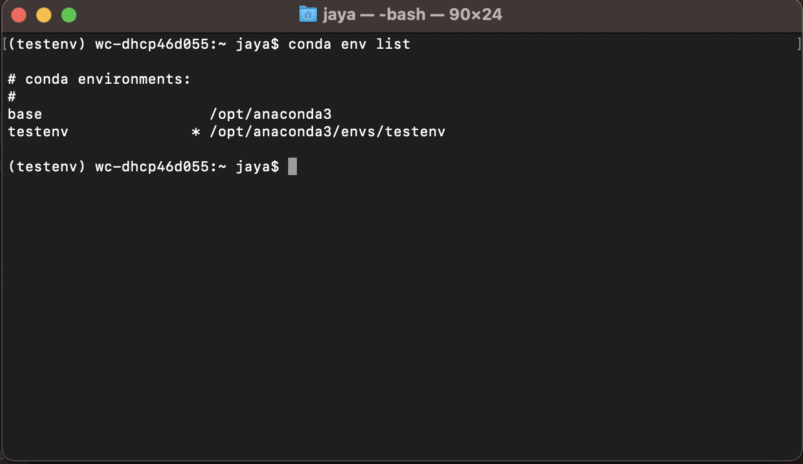
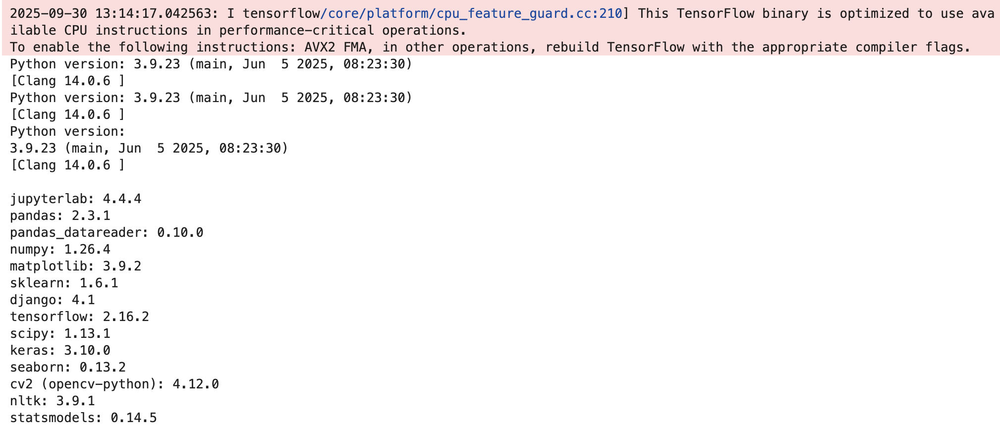
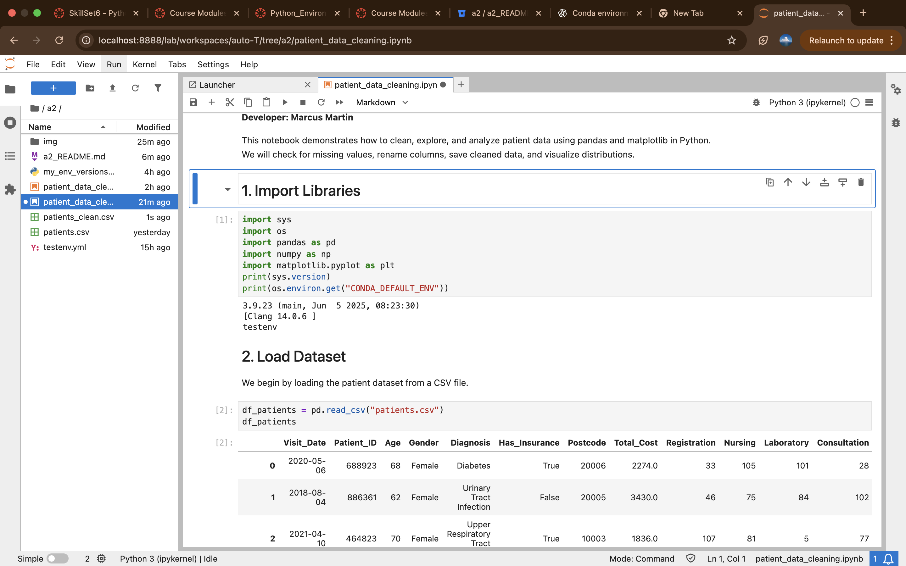
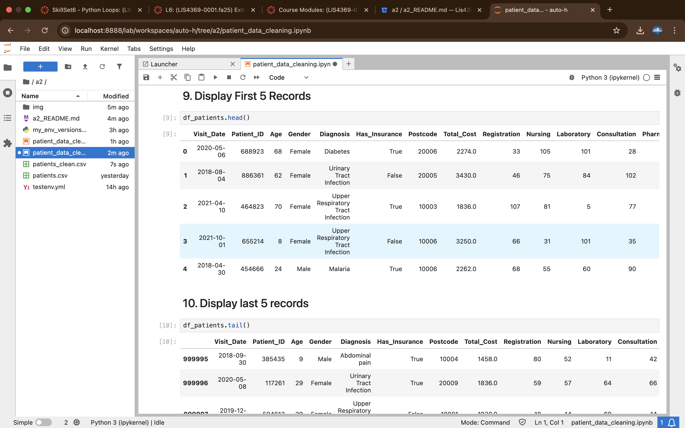
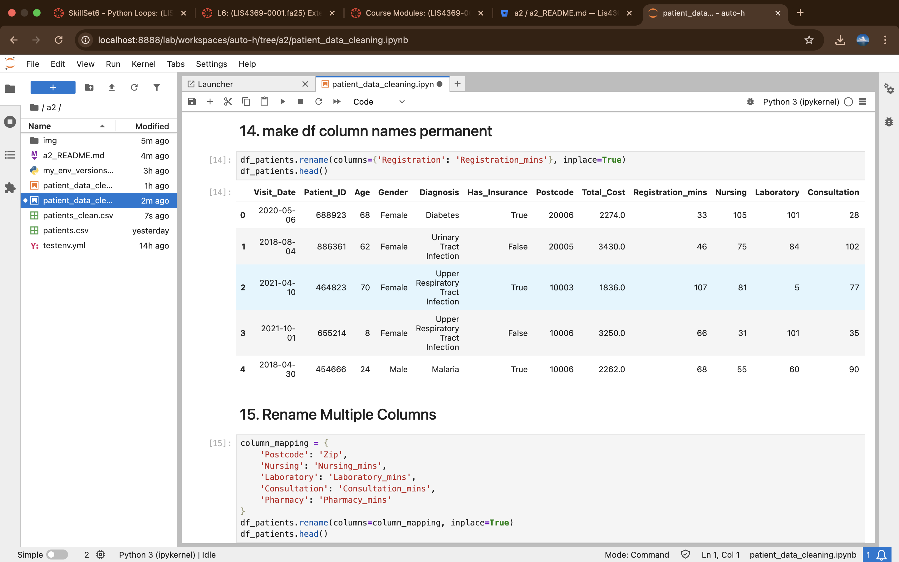
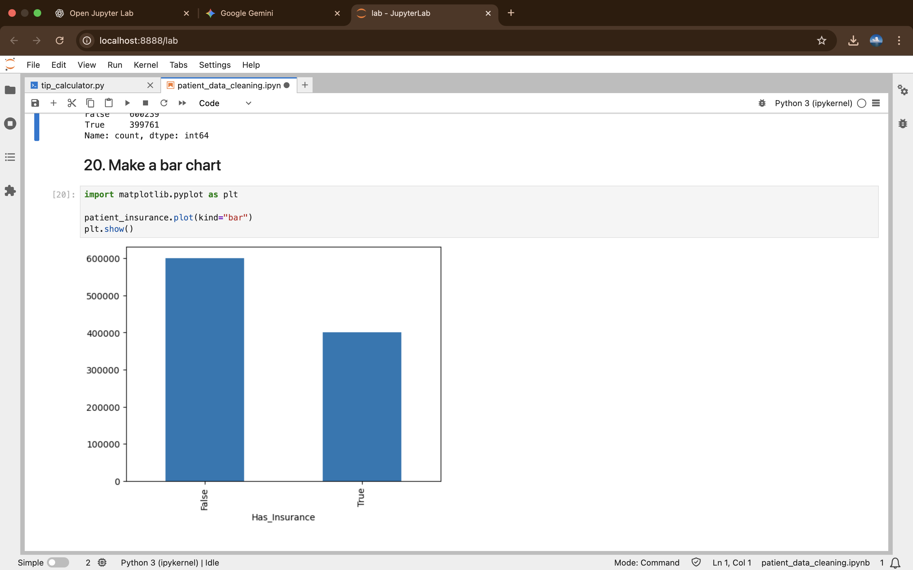
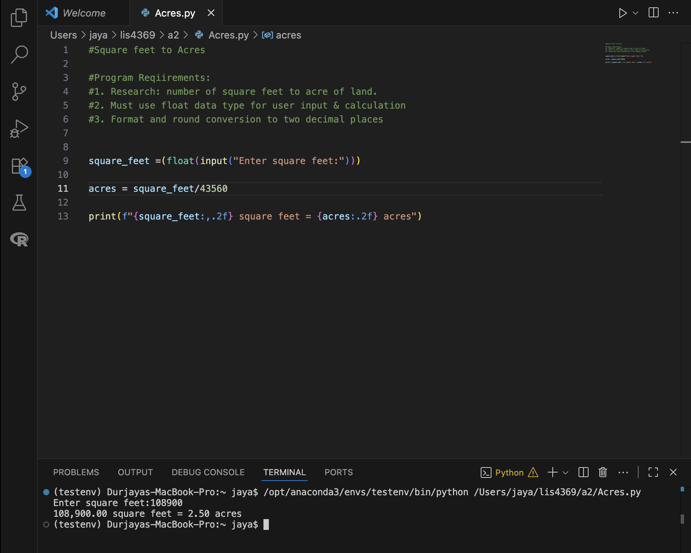
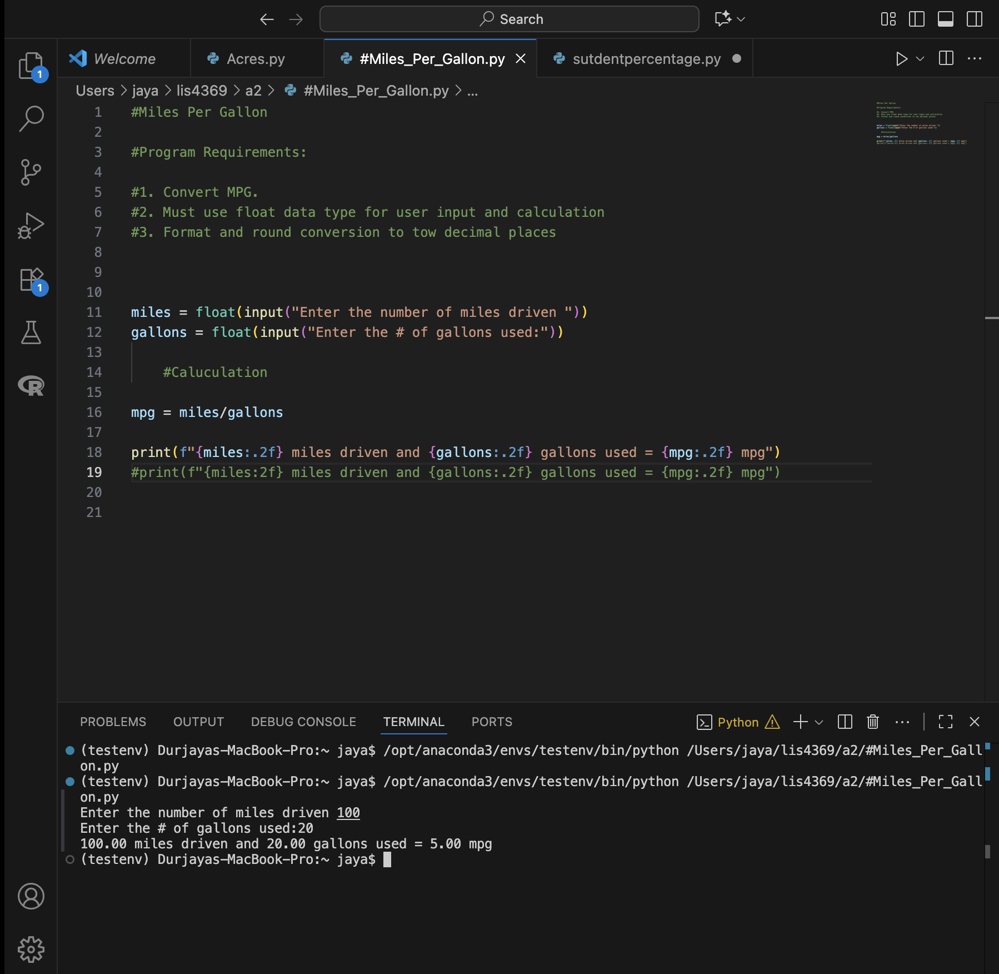
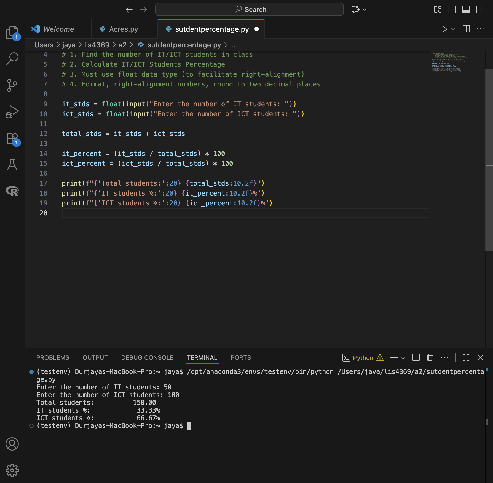

**NOTE:** This README.md file should be placed at the **root of each of your main 
directory.**

# LIS4369 Extensible Enterprise Solutions

## Marcus Martin

### Extensible Enterprise Solutions

*Course Work Links:*

1. 

    - Create conda environment
    - Export. yml file for testenv 
    - Backward engineer patients.csv 

# **Assignment Screenshots**

# **Link to my files**
[ymlfile](testenv.yml)

[Jupyterlabfile](patient_data_cleaning.ipynb)

[Pythonenv](my_env_versions.
py)

[patientsorg](patients.csv)

[patientsclean](patients_clean.csv)

