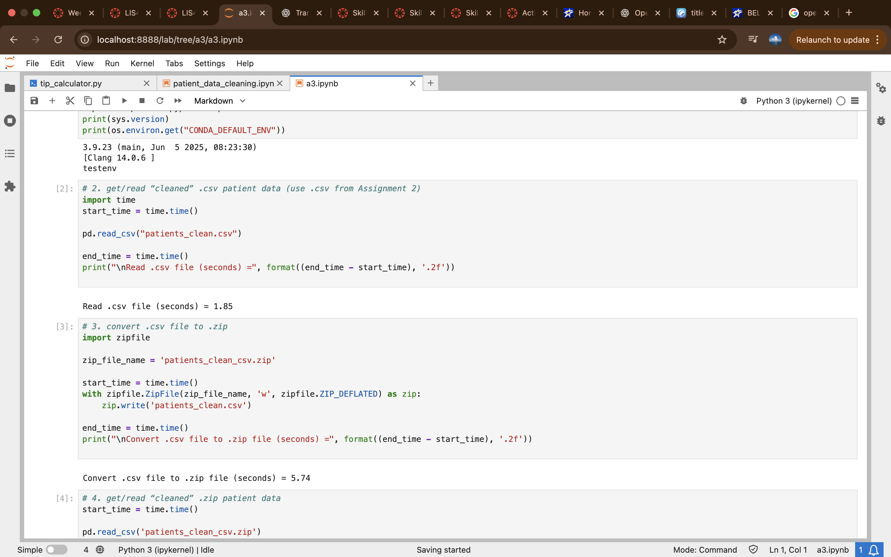
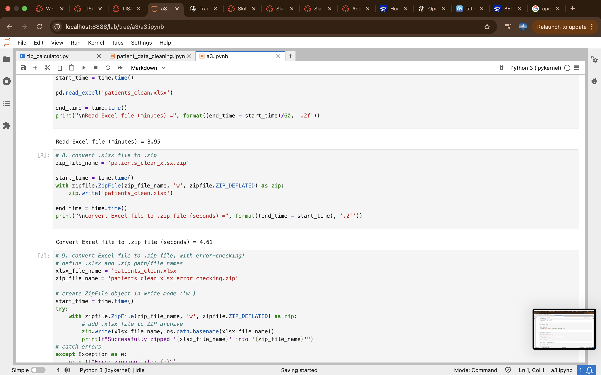
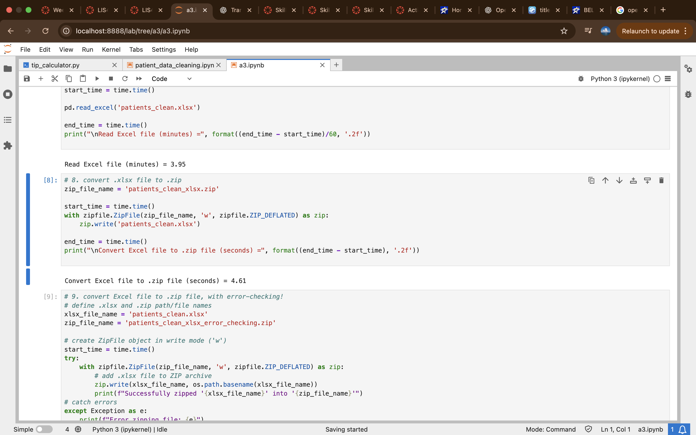
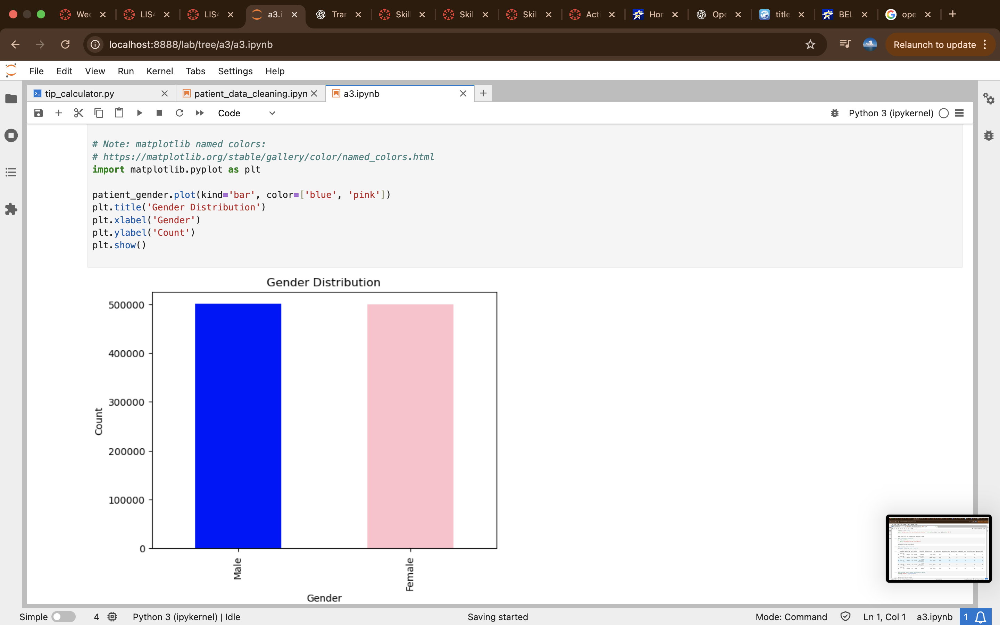
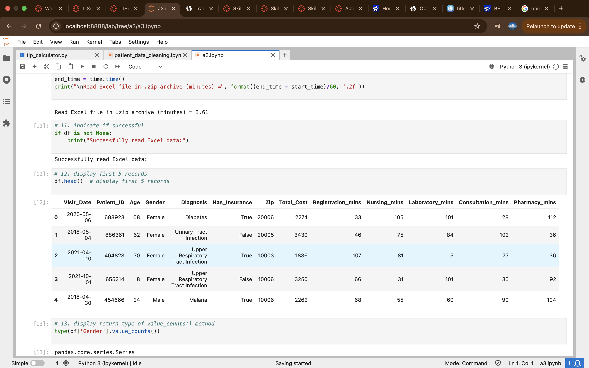
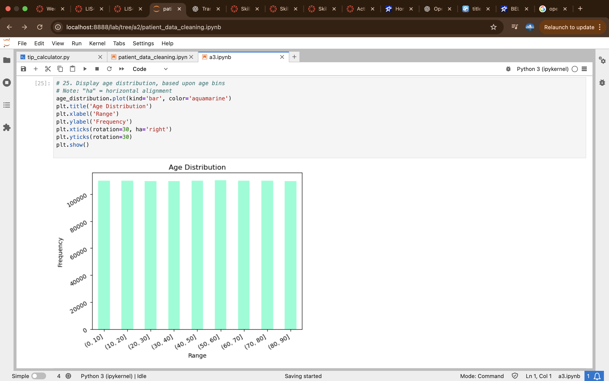
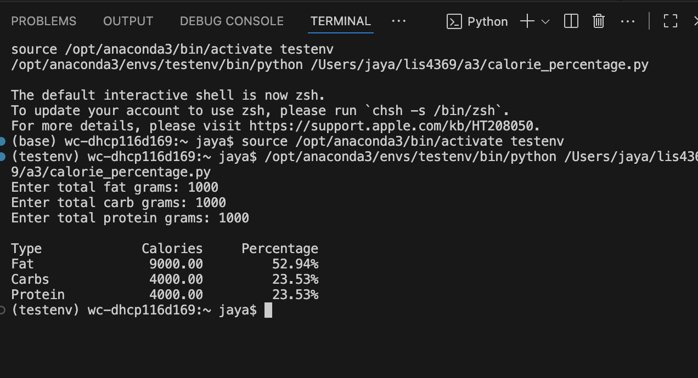
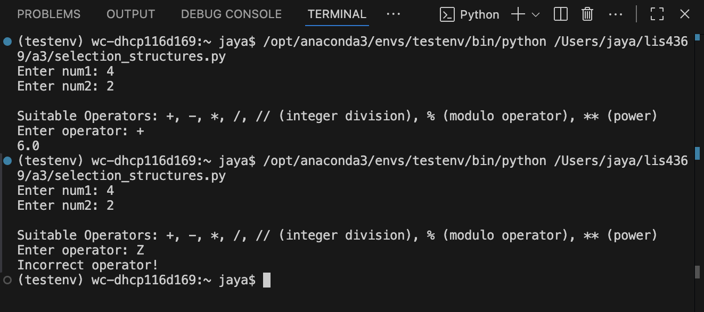
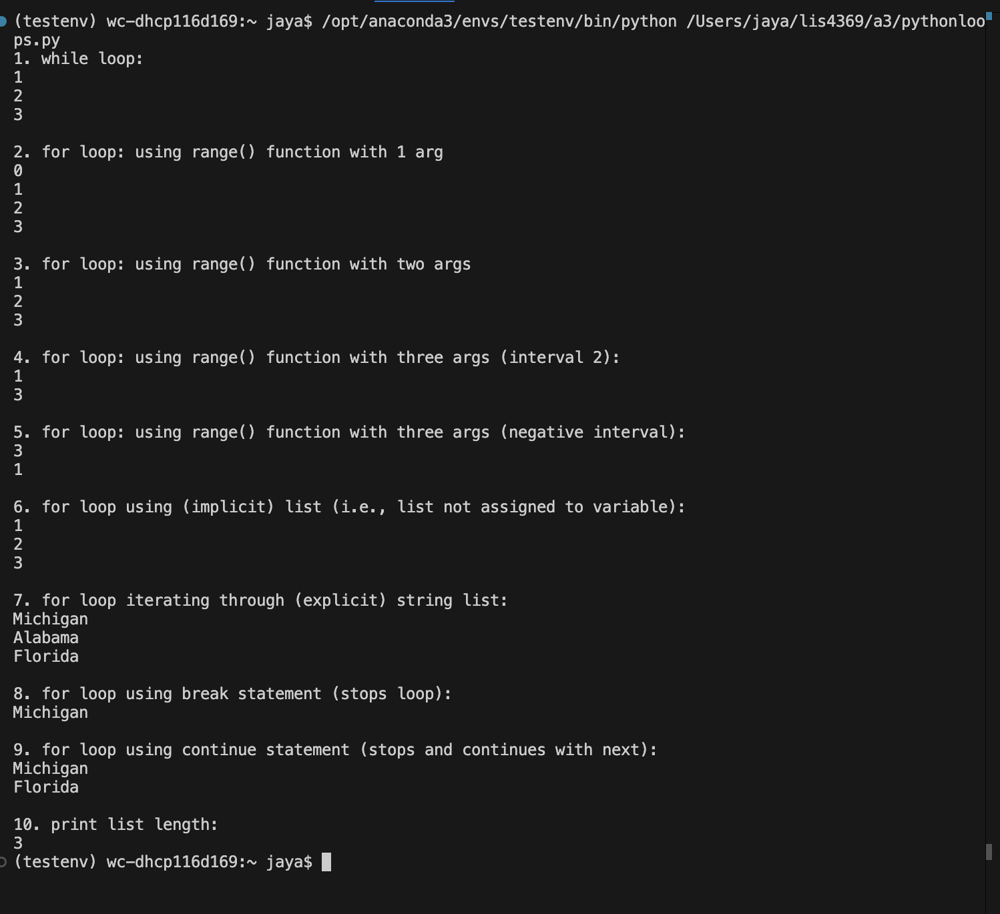

**NOTE:** This README.md file should be placed at the **root of each of your main 
directory.**

# LIS4369 Extensible Enterprise Solutions

## Marcus Martin

### Extensible Enterprise Solutions

*Course Work Links:*

1. 
    - Load files from cleaned csv file
    - Create Zip from csv file and convert into excel file 
    - Backward engineer pyhon scipt 

# **Assignment Screenshots**

# **Skillsets**

# **Link to my files**
[Excel](patients_clean.xlsx)
[Excelzip](patients_clean_xlsx.zip)
[Excelziperrorcheck](patients_clean_xlsx_error_checking_.zip)
[Csvzip](patients_clean_csv.zip)
[Jupyterlabfile](a3.ipynb)

[studentpercentage](studentpercentage.py)

[acres](acres.py)

[milespergallon](Miles_Per_Gallon.py)
