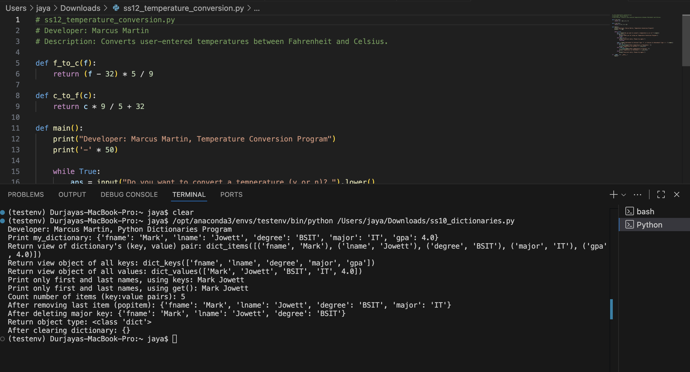
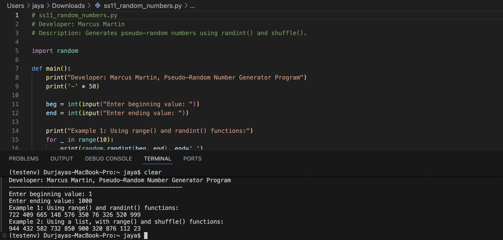
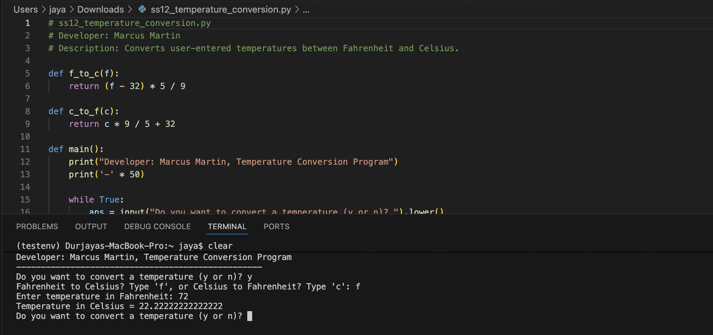

# LIS4369 Extensible Enterprise Solutions

## Marcus Martin

### Assignment 4 — Extensible Enterprise Solutions

*Course Work Summary:*

1. Implemented data extraction and visualization processes for real-world economic indicators.
2. Created an interactive dashboard to analyze unemployment and inflation trends.
3. Exported processed data to CSV files for further analysis and verification.

---

# **Assignment Screenshots**

---

# **Skillsets**

---

# **Linked Files**
- [Jupyter Notebook](a4.ipynb)
- [Demo](demo.py)
- [Inflation Data (CSV)](inflation.csv)
- [Unemployment Data (CSV)](unemployment.csv)
