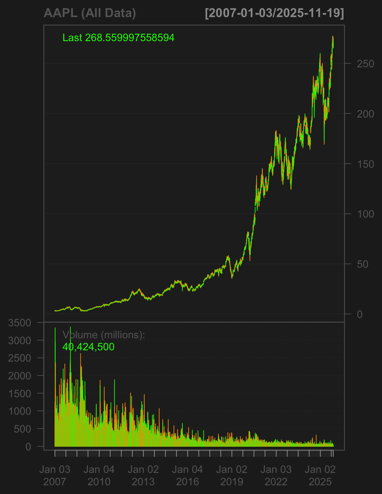
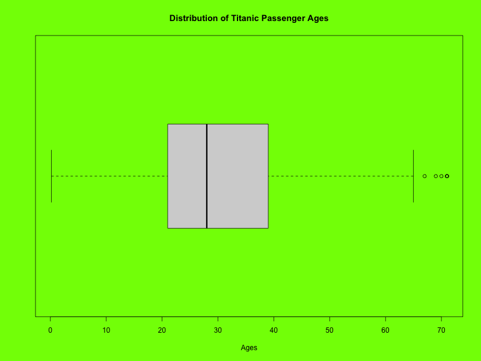
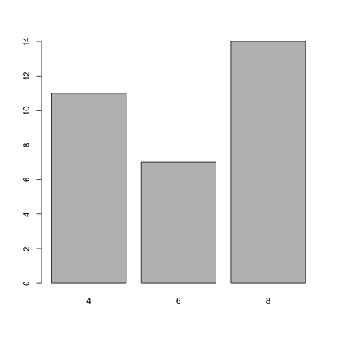
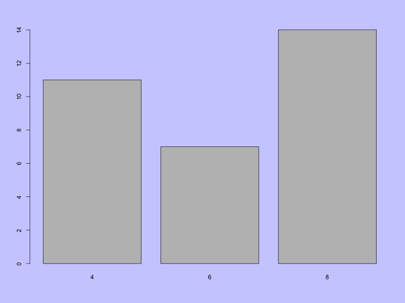
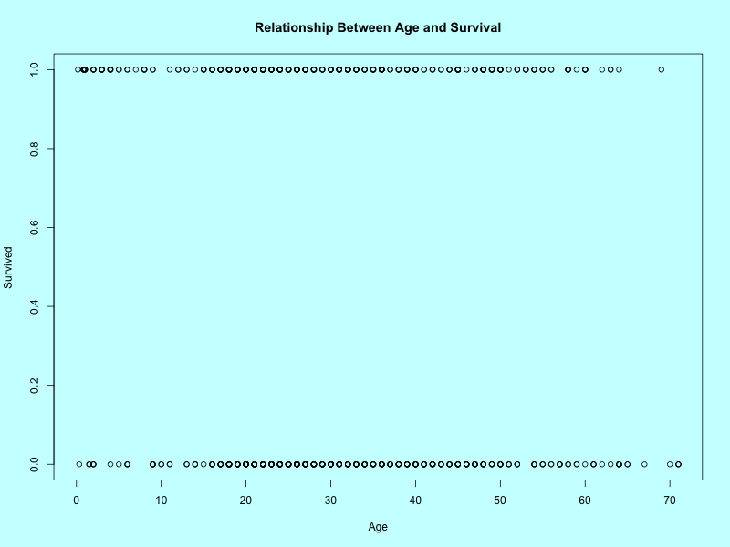
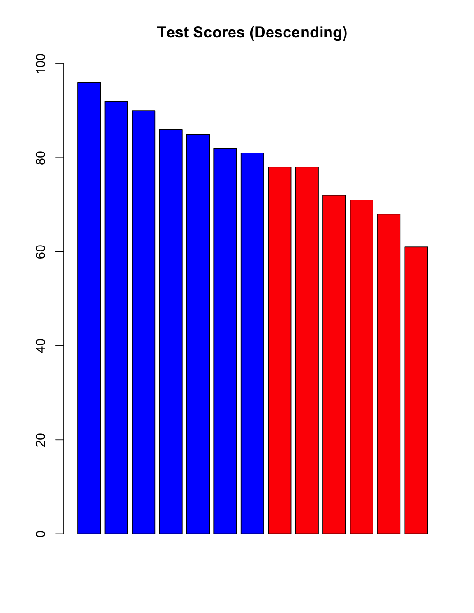
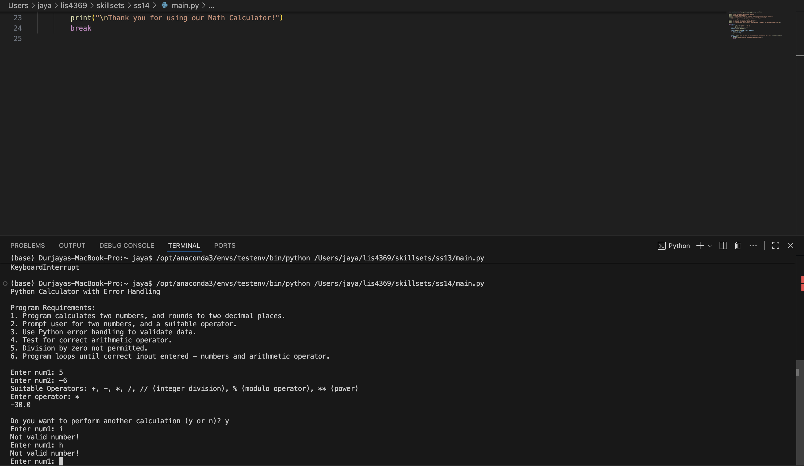
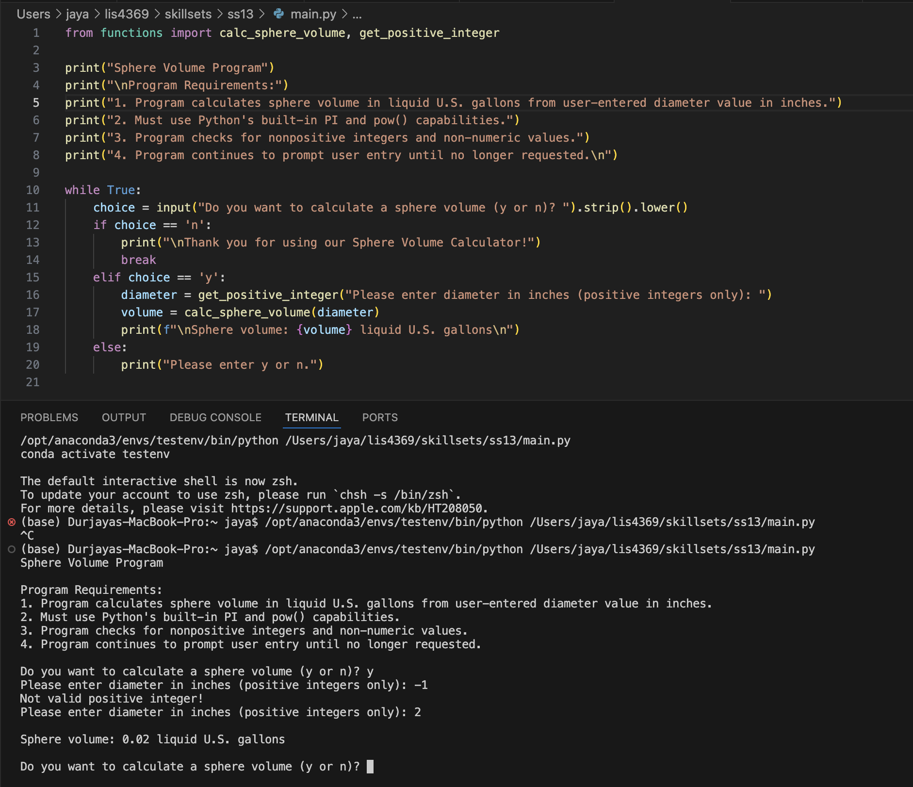
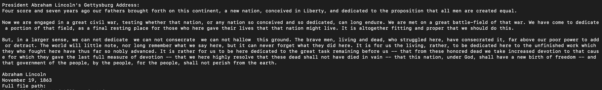

# LIS4369 Extensible Enterprise Solutions

## Marcus Martin

### Assignment 5 — Introduction to R

*Course Work Summary:*

1.  
    - Explored data manipulation and visualization using R.
    - Practiced base R plotting and ggplot2 techniques with built-in datasets.
    - Generated multiple chart exports and saved workspace/history files for reproducibility.

# **Assignment Screenshots**

# **Skillsets**

# **Linked Files**
- [learn_to_use_r.r](learn_to_use_r.r)
- [lis4369_a5.r](lis4369_a5.r)
- [my_workspace.RData](my_workspace.RData)
- [my_history.Rhistory](my_history.Rhistory)
- [myplotfile.pdf](myplotfile.pdf)
