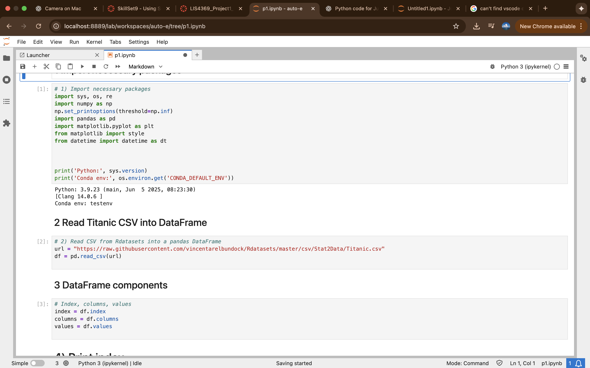
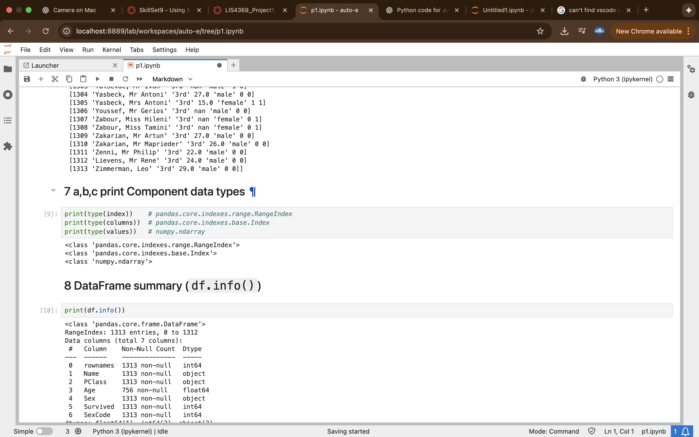
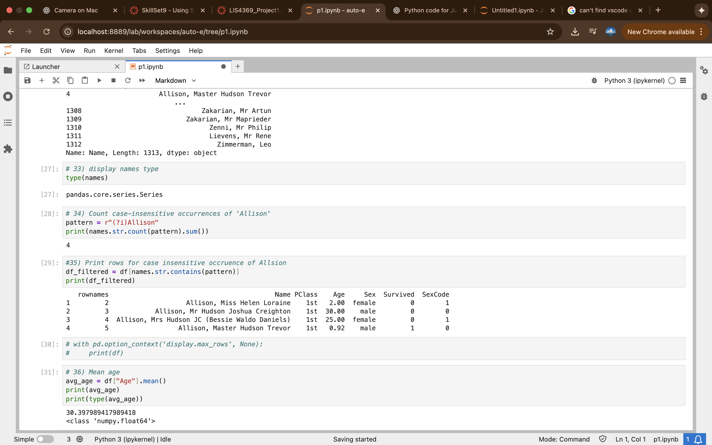
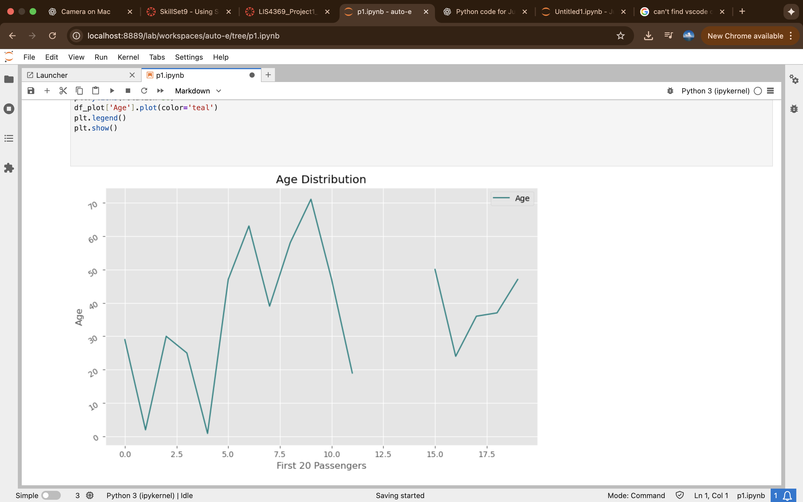
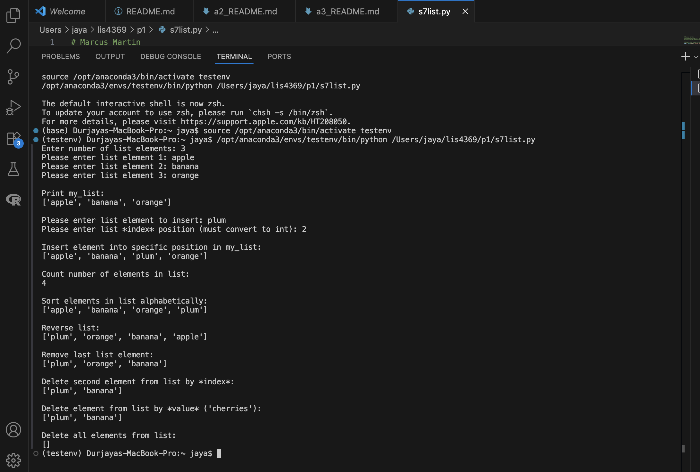
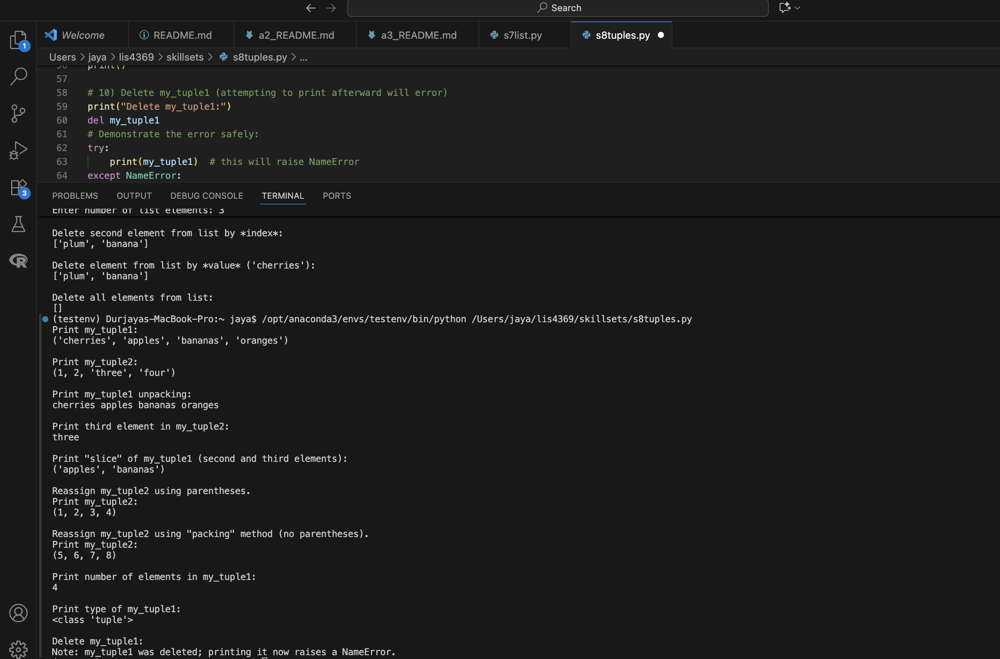
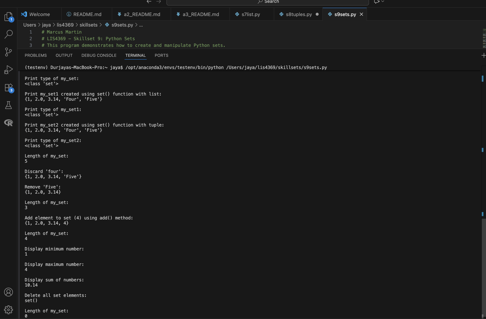

**NOTE:** This README.md file should be placed at the **root of each of your main 
directory.**

# LIS4369 Extensible Enterprise Solutions

## Marcus Martin

### Extensible Enterprise Solutions

*Course Work Links:*

1. 
    - Created sets using curly braces and the set() function with lists and tuples
     - Performed operations to add, remove, discard, and clear elements from sets
     - Calculated the minimum, maximum, and sum of numeric elements in a set

# **Assignment Screenshots**

# **Skillsets**

# **Link to my files**
[Jupyterlabfile](p1.ipynb)

