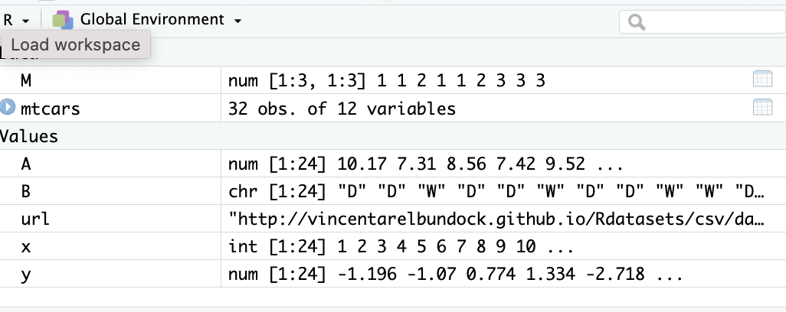
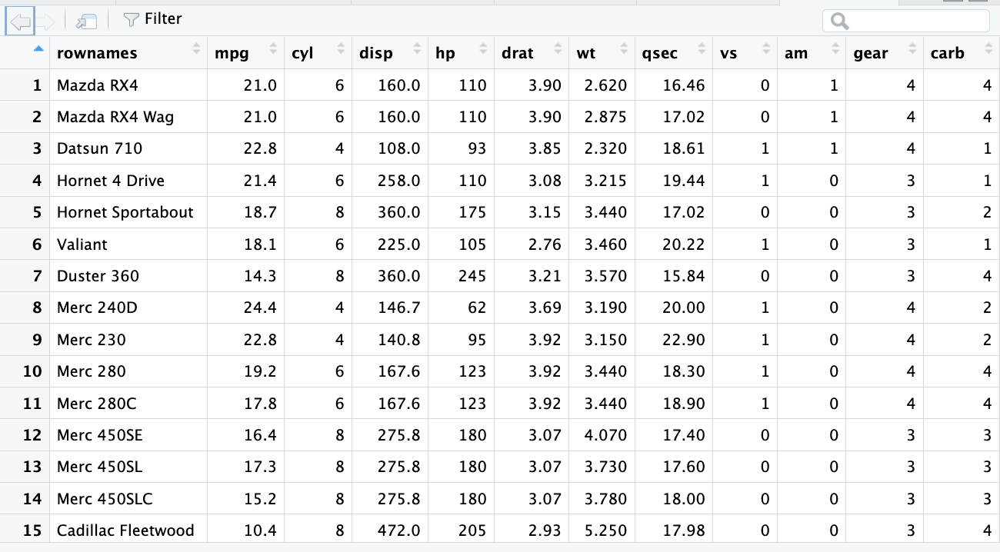
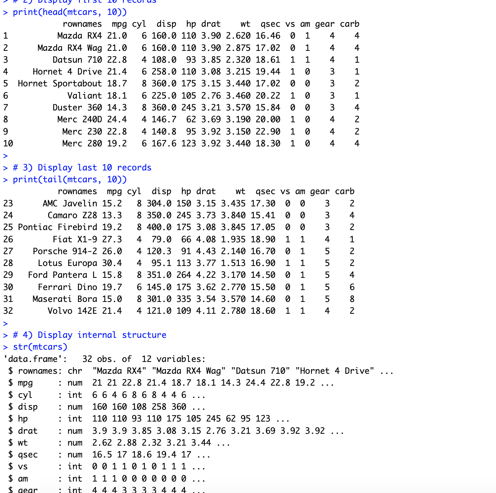
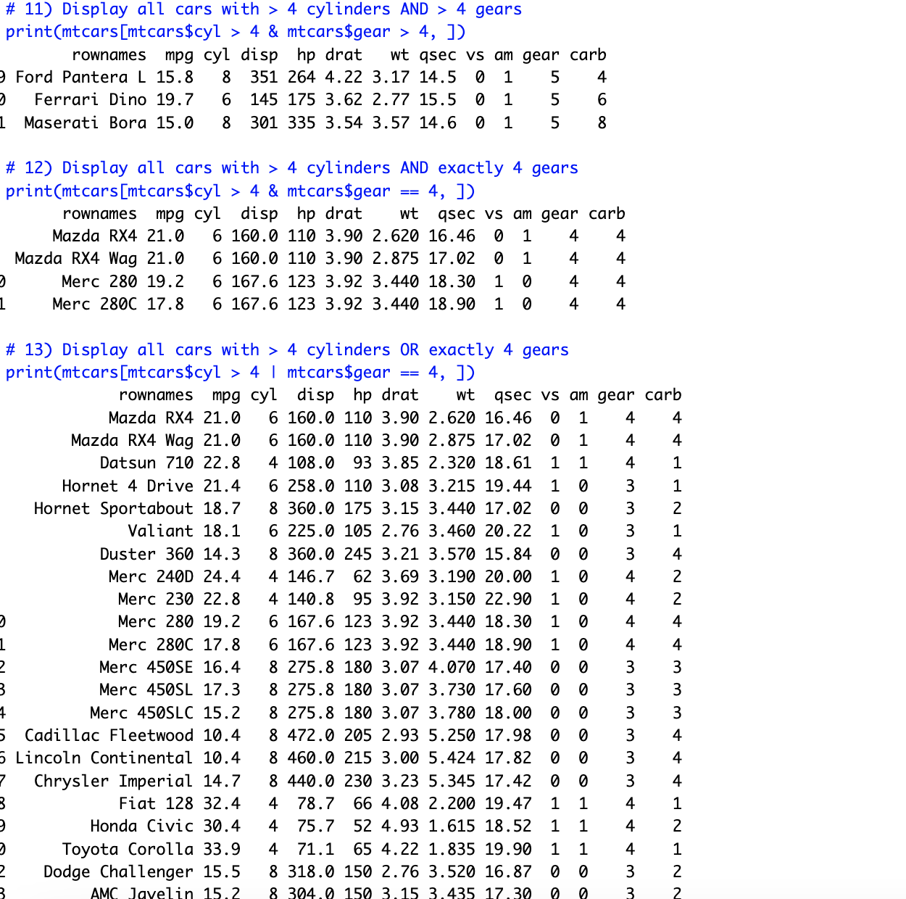
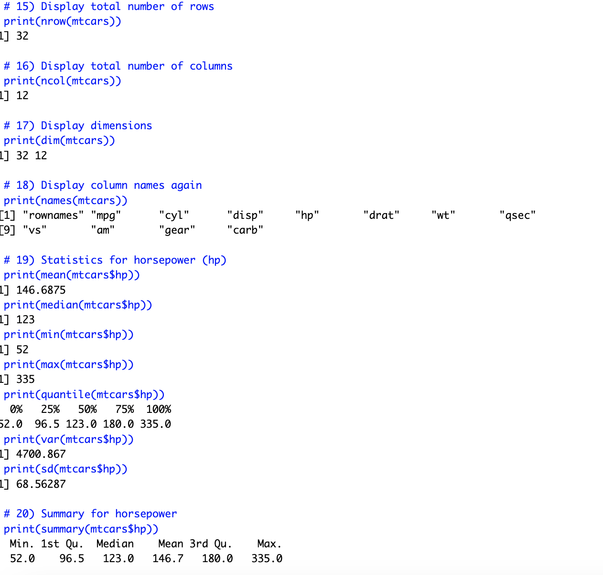
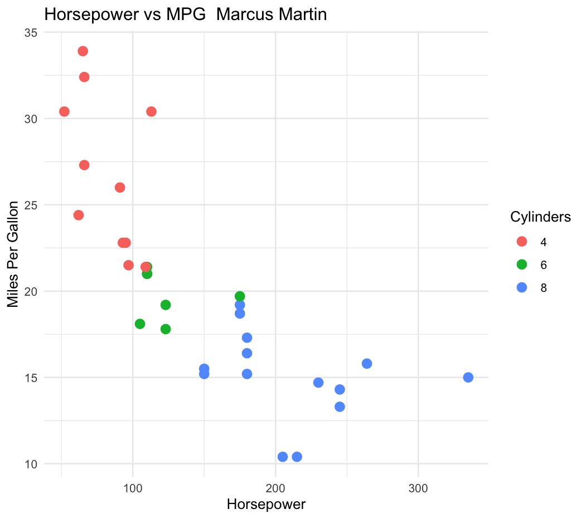

# LIS4369 Extensible Enterprise Solutions

## Marcus Martin

### Assignment P2 

*Course Work Summary:*

1.  
    - Load csv dataset into R
    - Explore r dataset and manipulate data 
    - Generate Plot 
# **Assignment Screenshots**

# **Linked Files**
- [lis4369_a2_output](lis4369_p2_output.txt)
- [lis4369_p2.r](lis4369_p2.r)

